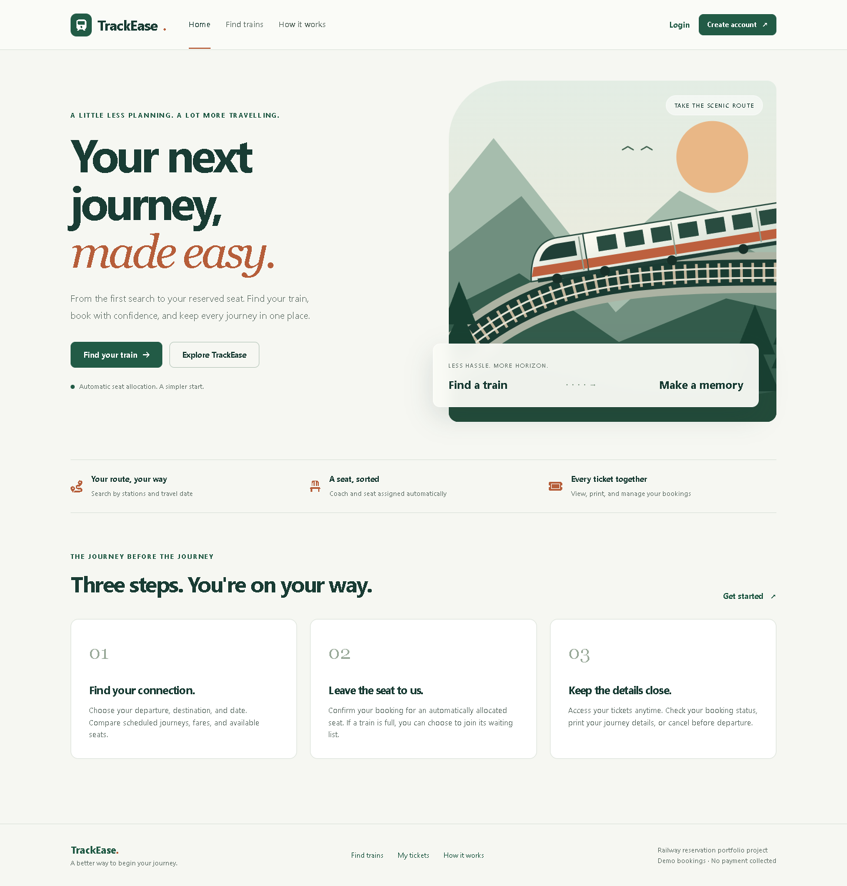
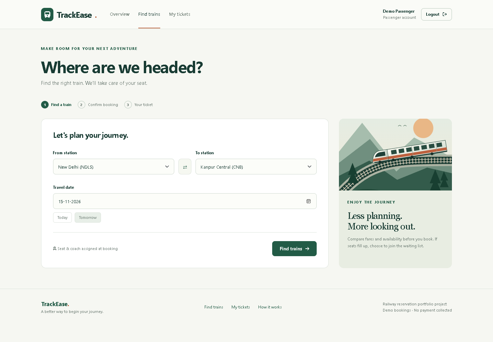
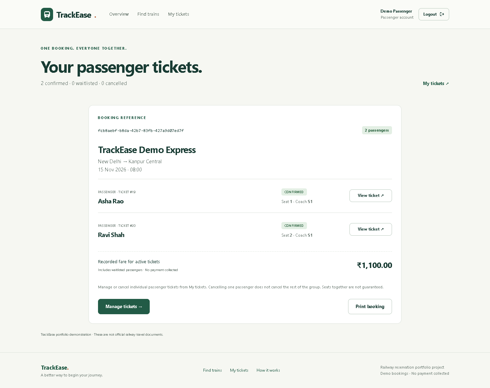
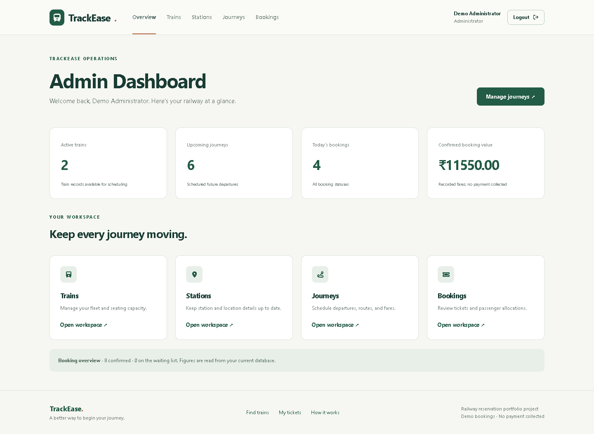
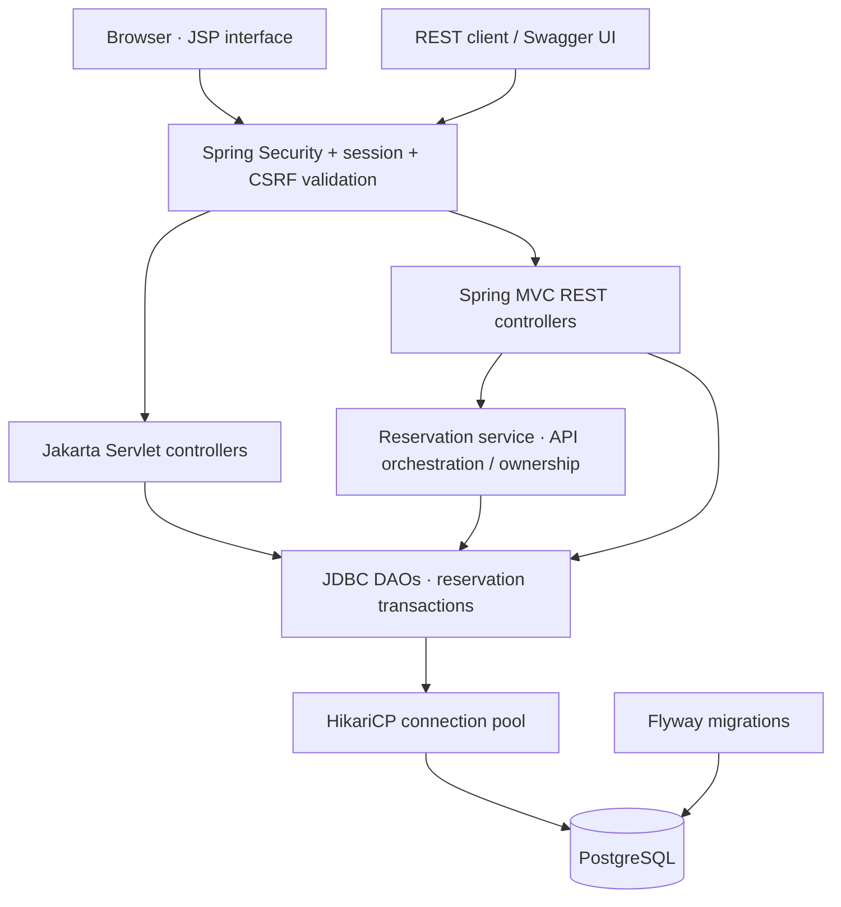

<div align="center">

# 🚆 TrackEase

### Railway reservations. Thoughtfully engineered.

Search journeys, book up to six passengers together, and manage every ticket—backed by transactional seat allocation and a FIFO waiting list.

[](https://github.com/ShambhaviSingh16/Online-Reservation-Portal/actions/workflows/ci.yml)


**[Live Demo](https://trackease-njtn.onrender.com) · [Live Swagger UI](https://trackease-njtn.onrender.com/swagger-ui.html) · [Quick Start](#quick-start) · [Engineering Decisions](#engineering-decisions) · [Testing](#testing)**

</div>

## Overview

TrackEase is a full-stack Java railway reservation application with passenger and administrator workflows, a responsive JSP interface, and a documented REST API. Its core challenge is keeping reservations correct when passengers compete for limited seats, retry a booking, cancel a ticket, or join a waiting list.

Originally developed in **Eclipse with Java Servlets and Tomcat 9**, the project has been modernized into a **Java 17 / Spring Boot application** using Jakarta Servlets, embedded Tomcat, Spring Security, PostgreSQL, and Docker. Development now runs in VS Code, with a build that also works independently of an IDE.

The application is a **single deployable system** with shared reservation logic behind the browser and API workflows. It demonstrates relational data modeling, transaction boundaries, authorization, integration testing, and deployment alongside the user interface.

> **Demo scope:** TrackEase is a portfolio application. Reservations are demonstrations, no payments are collected, and generated tickets are not official railway travel documents. The hosted demo uses Render's free web-service tier, so its first request after inactivity may take longer.

## What makes this project interesting

| Engineering problem | Implemented solution |
| --- | --- |
| Two requests competing for the same remaining seat | PostgreSQL journey-row locks, transactional capacity updates, and a unique active-seat index |
| A repeated click or retried request creating duplicate tickets | UUID request keys return the existing reservation instead of allocating again |
| A group being left with only some tickets after seats run out | One transaction covers all passengers; insufficient capacity rolls back the group unless waiting-list participation was explicitly allowed |
| A cancellation and a new booking racing for released capacity | Cancellation, inventory release, and waiting-list promotion share the journey lock and transaction |
| Historical tickets changing when schedules or fares are edited | Booked fares are snapshotted; train/station archival preserves history; conflicting journey changes are rejected |
| One user guessing another passenger's ticket ID | Server-side ownership checks, including API access and ticket pages |

## Product walkthrough

1. **Find a train:** select departure, destination, and travel date; compare fares, duration, and available seats.
2. **Add passengers:** book **1–6 named passengers** in one submission and review the total fare.
3. **Confirm:** the server checks current availability and assigns seats and coaches automatically.
4. **Review the booking:** view all passengers under one booking reference, with separate ticket statuses and seat details.
5. **Manage each ticket:** view, print, or cancel individual reservations before departure. Waiting passengers are promoted in queue order when capacity becomes available.

### Passenger features

- Account registration, login, logout, and a personalized dashboard.
- Station swapping and local-date shortcuts in journey search.
- Results sorted by departure time, fare, or duration.
- Automatic seat and coach allocation, with no manual seat-number entry.
- Group reservations with passenger names, a shared reference, and individual tickets.
- Explicit waiting-list consent, current queue positions, and automatic promotion.
- Ticket history with confirmed, waitlisted, and cancelled filters.
- Print-friendly individual tickets and group booking summaries.
- Responsive desktop/mobile layouts with locally served styles, scripts, and icons.
- Multi-stop reservations with segment fares and seat reuse between non-overlapping legs.
- STANDARD, SLEEPER, AC3, and AC2 inventory, best-effort berth preferences, and an interactive seat map.
- Two-minute selected-seat holds, automatic allocation, and explicitly opted-in RAC shared berths.
- Downloadable individual/group PDF tickets with ownership checks.
- Single-use email password-reset links, saved backup recovery codes, and session revocation after recovery.
- Booking, cancellation, and promotion emails through an optional delivery outbox.

Advanced features require a route and coach plan configured before bookings begin. Existing single-class journeys retain their original booking flow. See [advanced reservations](docs/ADVANCED_RESERVATIONS.md) and [free email setup](docs/EMAIL_SETUP.md).

### Administrator features

- Manage trains, stations, schedules, fares, and journey inventory.
- Archive trains and stations while retaining historical reservations.
- Search passenger bookings in the browser interface.
- View database-backed dashboard totals and recorded confirmed-booking value.
- Access paginated booking records and ticket audit events through the API.
- Retrieve 30-day booking counts and journey occupancy data through the analytics API.
- Configure intermediate stops, class fare multipliers, coaches, and a separate RAC quota.
- Search and filter trains, stations, journeys, and tickets with server-side pagination.

## Screenshots

Screenshots below show the working application with seeded **local demonstration data**. Hosted data may differ.

<div align="center">
  
</div>

<details>
<summary><strong>Explore journey search, group booking, and the admin dashboard</strong></summary>

### Journey search



### One booking, multiple passengers



### Administrator workspace



</details>

## Technology stack

| Layer | Technology |
| --- | --- |
| Language and build | Java 17, Maven |
| Application framework | Spring Boot 3.5, embedded Tomcat 10.1 |
| Browser workflows | Jakarta Servlets, JSP, HTML, CSS, JavaScript |
| UI components | Bootstrap 5.1.3, Font Awesome 6.0.0; jQuery 3.6.0 for retained admin forms |
| Authentication and authorization | Spring Security, server-side sessions, passenger/admin roles |
| Persistence | PostgreSQL, JDBC, HikariCP connection pooling |
| Schema management | Flyway versioned migrations |
| API | Spring MVC, Jakarta Bean Validation, OpenAPI / Swagger UI |
| Documents and notifications | Apache PDFBox, Brevo HTTPS API or local SMTP, transactional notification outbox |
| Verification | JUnit 5, PostgreSQL integration tests, HTTP smoke scripts, Playwright browser checks |
| Delivery | Multi-stage Docker build, Docker Compose, GitHub Actions, Render |

Dependencies are pinned in [`pom.xml`](pom.xml). PostgreSQL 17 is used in CI. The application uses JDBC rather than an ORM; authentication is session-based rather than JWT-based.

## Architecture



The existing servlet/JSP workflows were retained during the Spring Boot migration. REST endpoints use validated request models, and both entry points use the same JDBC reservation implementation. The application is packaged as an **executable WAR**, so a separate Tomcat installation is unnecessary.

### Engineering decisions

- **Lock at the journey boundary.** A booking locks its journey row before checking capacity and assigning a seat. Cancellation uses the same lock, keeping competing inventory changes in a consistent order.
- **Treat a group as one transaction.** Passenger tickets and audit events commit together. Group request keys are also serialized with PostgreSQL transaction-level advisory locks to handle concurrent retries.
- **Keep tickets individually manageable.** Group membership does not remove each passenger's status, waiting position, or cancellation lifecycle.
- **Record changes rather than erase history.** Cancelled tickets and booking events remain available; promotion events distinguish system actions from user actions.
- **Modernize incrementally.** Existing JSP and JDBC workflows remain usable while Spring Boot adds embedded hosting, security integration, pooling, migrations, and REST documentation.

### Reservation rules

| Rule | Behavior |
| --- | --- |
| Group size | 1–6 named passengers per group submission |
| Insufficient seats without waiting-list consent | No passenger tickets are committed |
| Insufficient seats with consent | Some passengers may be confirmed while others are waitlisted |
| Seat layout | Simplified coaches with up to 80 seats/berths; advanced journeys use configured classes and berth types |
| Seats together | Not guaranteed |
| Waiting-list order | Ticket creation order under the journey lock |
| Cancellation | Individual tickets, before departure; repeated cancellation cannot release capacity twice |
| Existing request retry | Returns the original reservation's current state; changing group passengers with the same key is rejected |
| Time handling | Railway schedule times use Asia/Kolkata |
| Fare handling | New tickets retain their booked fare; dashboard value is recorded fare, not collected revenue |
| Selected-seat hold | Two minutes; the server validates ownership and expiry at confirmation |
| Segment reuse | The same berth can serve non-overlapping route legs; overlapping claims are rejected transactionally |
| RAC | Separate configured sharing quota, two passengers per RAC berth; older eligible RAC tickets get full berths before waiting-list promotions |

Train capacity should be configured before bookings begin. Route, train, and capacity changes that would rewrite booked journeys are rejected. Legacy manual seat labels remain intact; legacy fares are initialized from their journey fare during migration because an original booked fare was not stored.

## Quick start

### Option 1: Docker Compose

**Requirements:** Git, Docker, and Docker Compose.

```bash
git clone https://github.com/ShambhaviSingh16/Online-Reservation-Portal.git
cd Online-Reservation-Portal
cp .env.example .env
```

On PowerShell, use `Copy-Item .env.example .env` for the last command. Open `.env` and replace `DB_PASSWORD` with a long, unique development password. Then run:

```bash
docker compose up --build
```

Open **[http://localhost:8080](http://localhost:8080)**. Compose starts PostgreSQL and the application; Flyway creates the schema automatically. Database data persists in the Compose volume.

**A fresh database starts empty.** Register a passenger account through the UI. Trains, stations, and journeys must be added through an administrator account before searches can return results. Demo accounts are not inserted by application startup.

<details>
<summary><strong>Create an administrator in your own local Compose database</strong></summary>

First register an account through the UI. Then, in a terminal with access to your local Compose project, replace `your_username` with that account's username:

```bash
docker compose exec db psql -U trackease -d trackease -c "UPDATE users SET role='admin' WHERE username='your_username';"
```

Log out and log in again to load the administrator role. Add stations, a train, and a future journey through the admin workspace. There is no public endpoint for granting administrator privileges.

</details>

### Option 2: Windows + VS Code + portable PostgreSQL

**Requirements:** JDK 17+, Maven 3.9+, PowerShell, and PostgreSQL binaries. The VS Code Extension Pack for Java is recommended for editing and debugging.

1. Clone the repository and open its folder in VS Code.
2. Download and extract the [EDB PostgreSQL Windows binaries](https://www.enterprisedb.com/download-postgresql-binaries) so that `.local/pgsql/bin/pg_ctl.exe` exists. PostgreSQL binaries and database data are not committed.
3. Start the local development environment:

   ```powershell
   powershell -NoProfile -ExecutionPolicy Bypass -File scripts/start-local.ps1
   ```

The script initializes an isolated database at `127.0.0.1:5433`, creates ignored local credentials, seeds demonstration records, builds the WAR, and starts the application on port `8080`. It is restricted to the workspace database; clear `DB_URL`, `DB_USER`, and `DB_PASSWORD` environment overrides before using this mode.

| Local seeded role | Username | Password |
| --- | --- | --- |
| Administrator | `admin` | `Admin123!` |
| Passenger | `demo` | `Demo123!` |

These credentials are **only for the portable local demo**. They are not hosted-demo credentials and should not be seeded into a public database. New accounts require passwords of 12–128 characters.

For a sample search, choose **New Delhi (NDLS) → Kanpur Central (CNB), tomorrow**.

```powershell
# Stop the application and local database
powershell -NoProfile -ExecutionPolicy Bypass -File scripts/stop-local.ps1

# Stop only the application before rebuilding its WAR
powershell -NoProfile -ExecutionPolicy Bypass -File scripts/stop-local.ps1 -KeepDatabase
```

VS Code also provides **TrackEase: run locally**, **TrackEase: stop locally**, and **TrackEase: build WAR** tasks. Use `scripts/start-local.ps1 -DebugServer` and the **Attach to local Tomcat (8000)** launch configuration for debugging. `-Port 8081` selects another HTTP port; `-SkipBuild` starts an existing WAR.

Local logs live in `.local/app.log` and `.local/app-error.log`; persistent database files live in `.local/pgdata`. Restart the app after changes. Use an external browser if an IDE preview blocks framed pages.

### Build independently of the IDE

With PostgreSQL configured through environment variables or `local.properties`:

```bash
mvn package
java -jar target/TrackEase.war --debug=false
```

Maven uses `.local/maven-repository` for its dependency cache. The root-level legacy WAR and the Eclipse `build/` and `bin/` outputs are not used by the current build.

## API documentation

| Resource | Local URL |
| --- | --- |
| Swagger UI | [localhost:8080/swagger-ui.html](http://localhost:8080/swagger-ui.html) |
| OpenAPI specification | [localhost:8080/v3/api-docs](http://localhost:8080/v3/api-docs) |
| Health endpoint | [localhost:8080/actuator/health](http://localhost:8080/actuator/health) |

### Authentication in Swagger

The API shares the application's session cookie. Use the same hostname for the UI and API documentation.

1. Execute `GET /api/auth/csrf`.
2. Copy its `token` into **Authorize → csrfToken**.
3. Execute `POST /api/auth/login` with your username and password.
4. Replace the authorized token with the **new `csrfToken` returned by login**.
5. Try protected endpoints. The browser manages the session cookie automatically.

Unsafe JSON requests require `X-CSRF-Token`. Login rotates the session; logout invalidates it. Administrator endpoints require an administrator account.

### Key endpoints

| Method | Endpoint | Purpose |
| --- | --- | --- |
| GET | `/api/auth/csrf` | Obtain a session CSRF token |
| POST | `/api/auth/register`, `/api/auth/login`, `/api/auth/logout` | Account/session lifecycle |
| GET | `/api/auth/me` | Current authenticated account |
| GET | `/api/stations` | Available station choices |
| GET | `/api/journeys/search` | Search by departure station, arrival station, and date |
| POST | `/api/bookings` | Single-ticket reservation |
| POST | `/api/bookings/group` | Reserve 1–6 named passengers |
| GET | `/api/bookings/group/{bookingId}` | Retrieve your shared booking and passenger tickets |
| GET / DELETE | `/api/bookings/{id}` | Retrieve or cancel your ticket |
| GET | `/api/bookings/history` | Paginated personal booking history |
| GET / POST | `/api/admin/trains`, `/api/admin/stations`, `/api/admin/journeys` | List/create operational records |
| PUT / DELETE | `/api/admin/trains/{id}`, `/api/admin/stations/{id}`, `/api/admin/journeys/{id}` | Update records; archive trains/stations or delete unused journeys |
| GET | `/api/admin/bookings` | Paginated administrator booking records |
| GET | `/api/admin/bookings/{id}/events` | Ticket audit events |
| GET | `/api/admin/analytics` | Summary totals, daily booking counts, and occupancy data |
| PUT | `/api/admin/journeys/{id}/plan` | Configure stops, classes, and coaches before booking |
| GET | `/api/journeys/segments`, `/api/journeys/{id}/plan`, `/api/journeys/{id}/seats` | Search segments and inspect class/seat inventory |
| POST / DELETE | `/api/bookings/holds`, `/api/bookings/holds/{id}` | Hold selected seats or release your hold |
| POST | `/api/bookings/advanced` | Reserve a segment with class, berth preference, and optional RAC |
| GET | `/api/bookings/{id}/pdf`, `/api/bookings/group/{id}/pdf` | Download your PDF documents |
| GET | `/api/admin/catalog` | Filtered, paginated operational records |
| POST | `/api/account/recovery-codes`, `/api/auth/recover` | Generate saved codes or recover an account |
| POST | `/api/auth/password-reset/request`, `/api/auth/password-reset/complete` | Request and consume an email reset link |
| GET | `/api/journeys/provider` | Railway provider configuration status |

### Example: group reservation

Send this JSON to `POST /api/bookings/group` with your session cookie and CSRF header. Replace `journeyId` with a real future journey and generate a fresh UUID for an intentional new booking.

```json
{
  "journeyId": 1,
  "requestId": "e757051a-c70f-4d98-aeaa-b45967f93dda",
  "passengerNames": ["Asha Rao", "Ravi Shah"],
  "joinWaitingList": false
}
```

The response contains a `bookingId` and the passenger `tickets`. Repeating the same valid request returns the existing tickets. With `joinWaitingList: false`, insufficient capacity returns a conflict and creates no tickets.

Validation errors return **400**; missing authentication **401**; forbidden actions or invalid CSRF **403**; inaccessible ticket/group references **404**; unavailable inventory or conflicting records **409**. Database/service failures return a generic error rather than exposing SQL or stack traces.

## Security

- **Password storage:** salted PBKDF2-HMAC-SHA256 with 600,000 iterations; legacy plaintext passwords upgrade on successful authentication.
- **Session handling:** fresh sessions on login, HttpOnly/SameSite cookies, POST-only logout, and secure cookies in the production profile.
- **Authorization:** passenger/admin route checks plus ticket and group ownership checks.
- **CSRF protection:** session-bound tokens for JSP forms and `X-CSRF-Token` validation for unsafe API requests, implemented by the application's shared CSRF filter.
- **Output and input handling:** escaped JSP output, prepared SQL statements, and server-side API validation.
- **Configuration:** database credentials come from environment variables or an ignored local file; production startup does not seed default accounts.
- **Account recovery:** only hashes of reset tokens and backup codes are stored; reset links expire after 30 minutes. Successful recovery invalidates existing sessions and outstanding recovery credentials.

Legacy accounts that have not logged in still require migration or a password reset. Existing duplicate confirmed seat labels require review before applying the unique-seat migration; migrations do not silently delete conflicting bookings.

## Testing

The latest local verification completed **42 JUnit tests with zero failures, errors, or skips**, including **35 PostgreSQL integration tests**. Test counts describe the verified implementation; workflow status and generated reports provide current build evidence.

| Verification layer | Coverage |
| --- | --- |
| Unit/validation tests | Password hashing, HTML escaping, invalid API inputs, OpenAPI security configuration |
| PostgreSQL integration tests | Concurrent seat allocation, final-seat contention, retries, rollback, coach boundaries, cancellation, FIFO promotion, fare snapshots, archival, and group-booking races |
| HTTP smoke tests | Passenger/admin journeys, single-ticket compatibility, ownership, CSRF failures, API booking lifecycle, waiting-list promotion, and audit data |
| Browser checks | Desktop/mobile layouts, local UI assets with third-party requests blocked, search interactions, booking dialogs, ticket filters, and admin pages |
| Group browser/API checks | Multiple named passengers, total fare, unique seats, retry safety, validation, ownership, individual cancellation, mobile rendering, and print output |
| Swagger browser checks | Real Try it out flow: CSRF setup, login, session refresh, authenticated access, and logout |
| Advanced integration tests | Overlapping-seat contention, segment reuse, atomic holds/groups, hold expiry, class fares, RAC sharing/promotion, recovery-token reuse, notification delivery, and PDF contents |

```powershell
# Unit tests; database integration tests are opt-in
mvn test

# Requires the portable local PostgreSQL configuration at 127.0.0.1:5433
mvn "-Dtrackease.integration=true" verify

# Requires the running, seeded local application
powershell -NoProfile -ExecutionPolicy Bypass -File scripts/smoke-local.ps1
powershell -NoProfile -ExecutionPolicy Bypass -File scripts/smoke-api.ps1

# Optional browser harness; uses installed Microsoft Edge or Google Chrome
npm install --prefix .local/browser-test --no-audit --no-fund playwright
node scripts/smoke-ui.cjs
node scripts/smoke-group.cjs
node scripts/smoke-swagger.cjs
```

`scripts/smoke-features.cjs` additionally exercises advanced workflows through the browser and captures real JavaMail traffic in an in-process local SMTP inbox. It requires the test email configuration described in [EMAIL_SETUP.md](docs/EMAIL_SETUP.md); it never sends mail to an external provider.

Integration tests create and remove a **disposable schema** in the local database. They reject remote database URLs and do not truncate demonstration tables. HTTP/browser checks create local test records; retained ticket and audit history is intentional. Surefire reports are written to `target/surefire-reports`; browser screenshots and print artifacts go to `.local/`.

The [GitHub Actions workflow](.github/workflows/ci.yml) builds with Java 17, runs the unit and PostgreSQL integration tests, builds the Docker image, and uploads verification reports. CI builds are separate from Render deployments.

## Deployment and configuration

The [Dockerfile](Dockerfile) builds the executable WAR from source in a Maven stage, then runs it in a Java 17 runtime image. Render provides the HTTP port through `PORT`.

| Variable | Purpose | Example |
| --- | --- | --- |
| `DB_URL` | JDBC PostgreSQL connection URL | `jdbc:postgresql://YOUR_HOST:5432/YOUR_DATABASE` |
| `DB_USER` | Database username | Your database user |
| `DB_PASSWORD` | Database password | Set in the hosting provider's secret configuration |
| `SPRING_PROFILES_ACTIVE` | Production HTTPS/proxy settings | `prod` on Render |
| `PORT` | HTTP listening port | Supplied by Render; defaults to `8080` locally |
| `MAIL_PROVIDER` | Optional email transport | `none` by default; `brevo` for Render |
| `BREVO_API_KEY` | Brevo transactional email credential | Set privately in Render, never in Git |
| `MAIL_FROM` | Verified sender address | Your verified sender |
| `PUBLIC_BASE_URL` | Trusted base URL for recovery/ticket links | `https://trackease-njtn.onrender.com` |

Use a PostgreSQL database in the same region as the web service when using Render's internal network. Configure actual database values rather than copying placeholder hostnames. The production profile enables secure session cookies and forwarded-header handling for the HTTPS proxy.

Flyway runs the migrations in [`src/main/resources/db/migration`](src/main/resources/db/migration) at startup:

| Version | Change |
| --- | --- |
| V1 | Reservation schema and baseline modernization |
| V2 | System actor support for automatic waiting-list promotion |
| V3 | Group-booking references and passenger names |
| V4 | Backup recovery codes and credential versions |
| V5 | Classes, route segments, seat holds, and RAC occupancy |
| V6 | Email reset tokens and transactional notification outbox |

Existing schemas are baselined at version 0. Add a new migration for future changes rather than editing applied versions. `database/schema.sql` also supports portable local provisioning and disposable integration-test schemas.

**Fresh hosted databases contain no demo users, stations, trains, or journeys.** Account and operational data must be provisioned separately. Hosting database retention/expiry is provider-dependent; the public demo is not a permanent data archive.

## Repository structure

```text
├── src/main/java/com/trainticket/
│   ├── api/              # Validated REST endpoints and API errors
│   ├── config/           # Security, data-source integration, OpenAPI
│   ├── controller/       # Jakarta Servlet browser workflows
│   ├── dao/              # JDBC queries, locking, reservation transactions
│   ├── filter/           # Shared CSRF validation
│   ├── model/            # Users, trains, stations, journeys, tickets
│   ├── service/          # API reservation orchestration and ownership
│   └── util/             # Database access, hashing, escaping
├── src/main/resources/   # Configuration and Flyway migrations
├── src/main/webapp/      # JSP views and local UI assets
├── src/test/             # Unit and PostgreSQL integration tests
├── database/             # Local schema and demonstration seed data
├── scripts/              # Development lifecycle and smoke checks
├── docs/images/          # Screenshots of the working application
├── .github/workflows/    # CI build and verification
├── Dockerfile
├── compose.yaml
└── pom.xml
```

## Current scope and next steps

The implementation includes advanced segment reservations, class inventory, seat holds, RAC, PDF documents, account recovery, and optional email delivery alongside the original reservation workflow.

- **Live railway data:** an integration interface and configuration-status endpoint are ready. No authorized provider is connected; local timetable data remains administrator-managed.
- **Email activation:** requires a free provider account, verified sender, and environment credentials. Delivery is disabled by default; see [EMAIL_SETUP.md](docs/EMAIL_SETUP.md). Local delivery tests do not establish external inbox deliverability.
- **Reservation model:** berth layouts and RAC quotas are simplified portfolio rules, not a reproduction of official railway allocation policy. Preferences and seats together are not guaranteed.
- **PDF characters:** bundled fonts cover common Latin text; unsupported characters are marked in the document while the original name remains available in the application.
- **Payments and additional production operations:** outside this implementation's agreed scope. No money is collected.

## Author

**[Shambhavi Singh](https://github.com/ShambhaviSingh16)**

TrackEase documents the evolution of a servlet-based academic project into a tested, deployable full-stack Java application—with particular attention to booking correctness, clear user workflows, and maintainable delivery.
